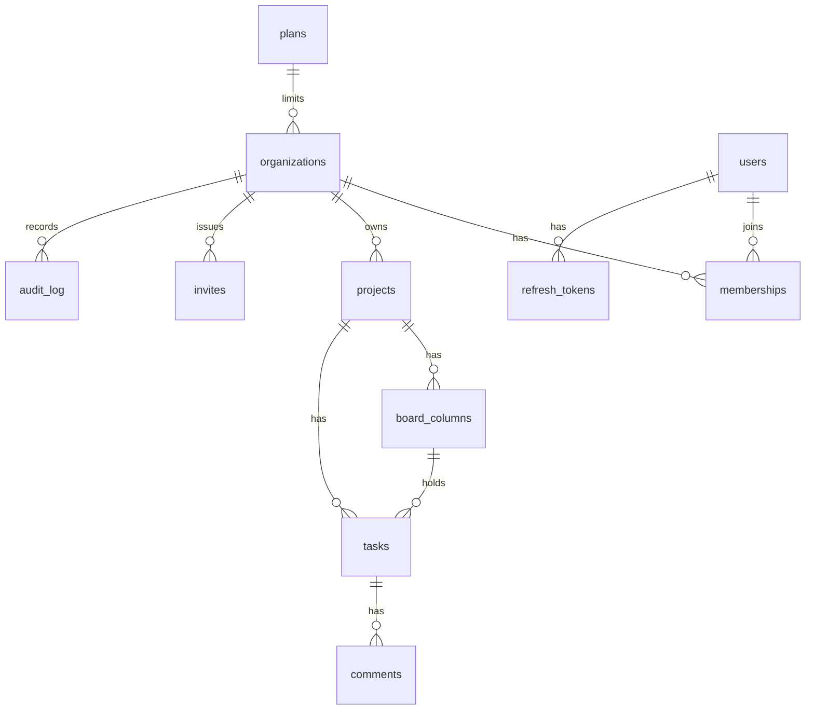

## ER diagram

## API summary
Full list in Swagger (`/api/docs`) and `docs/postman_collection.json`. Groups: `/auth`, `/me`, `/orgs`, `/members`, `/invites`, `/projects`, `/tasks`, `/activity`, `/notifications`, `/search`, `/dashboard`, `/admin`, `/health`. Errors: `{ error: { code, message, details } }`.
## Design trade-offs
1. **Shared schema + `organization_id`** instead of a database per tenant: cheap to run and scale to thousands of orgs, but isolation depends on the single scoped data layer (covered by tests).
2. **Raw SQL with a tiny scoped helper** instead of an ORM: explicit, indexed queries and no N+1, at the cost of hand-written SQL.
3. **Heavy 3D only on the landing hero**; the app uses CSS glass and a Simple view, trading some spectacle for readability and 60fps.
## 60-second demo
1. Log in as `owner1@demo.orbita.io` (password `Demo12345`) and show the dashboard. 2. Open a project and drag a card across columns. 3. Open a second browser as `member1@…` in the same project and watch it update live. 4. Invite an email on Team and open it in Mailpit (:8025). 5. Switch to Nebula and Simple view. 6. Log in as `owner2@…` and show that org 1's projects are invisible.
